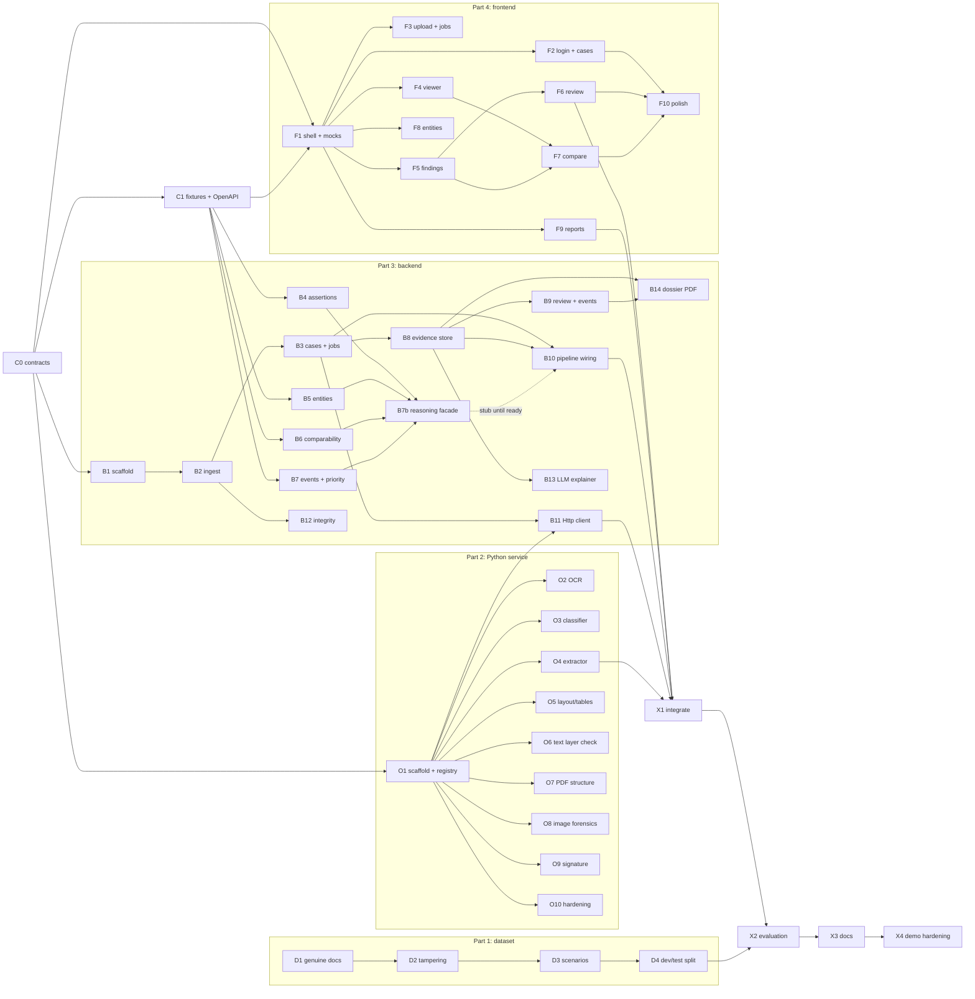

# TraceDocs: Build Plan (parts, batches, AI prompts)

Built from scratch. No TraceMail code is reused, so the organizers' permission rule for previously developed projects (4.3) does not apply. Ideas such as noisy-OR fusion are re-implemented from the design, not copied.

Source of truth: `ARCHITECTURE.md` (v2). If this plan and that file disagree, fix one of them before building.

---

## 1. How the plan keeps parts independent

Everything hangs off one idea: **contract first, fixtures second.**

- **Part 0** writes the shared contracts (TypeScript types, JSON Schema for the Python service output, OpenAPI for the REST API, a pydantic mirror) and a set of realistic fixtures.
- The **frontend** runs against a mock server fed by those fixtures, so it never waits for the backend.
- The **backend reasoning engine** (assertions, entities, comparability, priority) is made of pure functions driven by the fixtures, so it never waits for OCR.
- The backend talks to the Python service through an `AnalysisClient` interface with a mock implementation, so it never waits for the Python service.
- The **Python service** has a plugin registry. Every analyzer is one file that registers itself, so analyzers can be built in any order and the service works with whatever is present.
- The **sample dataset** is a standalone generator.

Real integration happens once, in batch X1.

### Parts

| Part | Folder | Batches | Depends on |
| --- | --- | --- | --- |
| 0. Contracts and fixtures | `contracts/` | C0, C1 | nothing |
| 1. Sample dataset | `samples/` | D1 to D4 | nothing |
| 2. Analysis service (Python) | `ocr-service/` | O1 to O10 | Part 0 |
| 3. Backend (Node) | `backend/` | B1 to B14 | Part 0 |
| 4. Frontend (React) | `frontend/` | F1 to F10 | Part 0 |
| 5. Integration, evaluation, docs | all | X1 to X4 | Parts 1 to 4 |

### Tier legend

- **M** = must (the demo breaks without it)
- **S** = should (clear score value, build if time allows)
- **C** = cut first

AI hint: **Claude** = judgment-heavy, security-sensitive or tricky logic; **Any** = well specified enough for a local or cheaper model.

---

## 2. Dependency map



### Batch dependency table

| Batch | Needs first | Tier | AI |
| --- | --- | --- | --- |
| C0 | none | M | Claude |
| C1 | C0 | M | Claude |
| D1 | none | M | Any |
| D2 | D1 | M | Claude |
| D3 | D1, D2 | M | Any |
| D4 | D3 | S | Any |
| O1 | C0 | M | Any |
| O2 | O1 | M | Any |
| O3 | O1, C1 (recorded OCR fixtures) | M | Any |
| O4 | O1, C1 (recorded OCR fixtures) | M | Claude |
| O5 | O1, C1 (recorded OCR fixtures) | S | Any |
| O6 | O1, C1 (recorded OCR fixtures) | S | Claude |
| O7 | O1 | M | Claude |
| O8 | O1 | M | Claude |
| O9 | O1 | C | Any |
| O10 | O1 (more useful after O2 to O8) | S | Any |
| B1 | C0 | M | Any |
| B2 | B1 | M | Claude |
| B3 | B2 | M | Claude |
| B4 | C0, C1 | M | Any |
| B5 | C0, C1 | M | Claude |
| B6 | C0, C1 | M | Claude |
| B7 | C0, C1 | M | Claude |
| B7b | B4, B5, B6, B7 | M | Claude |
| B8 | B3 | M | Any |
| B9 | B8 | M | Claude |
| B10 | B3, B8 (uses a stub of B7b until B7b exists) | M | Claude |
| B11 | B3, O1 | M | Any |
| B12 | B2 | S | Any |
| B13 | B8 | C | Claude |
| B14 | B8, B9 | M | Any |
| F1 | C0, C1 | M | Any |
| F2 | F1 | S | Any |
| F3 | F1 | M | Any |
| F4 | F1 | M | Claude |
| F5 | F1 | M | Any |
| F6 | F5 | M | Any |
| F7 | F4, F5 | S | Any |
| F8 | F1 | C | Any |
| F9 | F1 | M | Any |
| F10 | F2 to F9 (those that exist) | S | Any |
| X1 | B10, B11, O4, one of O7/O8, F3 to F6, F9 | M | Claude |
| X2 | D4, X1 | S | Claude |
| X3 | X2 (can start partially earlier) | M | Any |
| X4 | X1, X3 | M | Claude |

### Parallel tracks (if you have teammates)

| Track | Batches in order |
| --- | --- |
| Data + analysis | D1, D2, D3, D4 then O1, O2, O3, O4, O7, O8, O6, O5, O9, O10 |
| Backend | B1, B2, B3, then B4, B5, B6, B7 (any order), B8, B9, B10, B11, B14, B12, B13 |
| Frontend | F1, then F3, F4, F5, F6, F9, F7, F2, F8, F10 |
| Shared | C0 and C1 first, X1 to X4 last |

### Suggested order if you build alone

C0, C1, D1, D2, D3, O1, O2, O3, O4, O8, O7, B1, B2, B3, B4, B5, B6, B7, B8, B10, B11, F1, F3, F4, F5, B9, F6, B14, F9, X1, then X2, X3, X4.

Cut line if time runs short: drop O9, F8, B13, F7, then O5, O6, B12, F2, F10, in that order. The mandatory prototype in the problem statement needs ingestion, extraction, some visual forensics (O7 or O8), cross-document inconsistency detection, evidence mapping, a dossier and a review interface.

---

## 3. How to run a batch

1. Open a fresh AI chat or session.
2. Paste the **common preamble** (next section), then the batch prompt.
3. Attach `ARCHITECTURE.md`, the `contracts/` folder, and any file the prompt names.
4. Let the AI write code and tests, run the tests, and fix failures.
5. Check the batch's **Done when** line yourself.
6. Commit once per batch with the batch ID in the message (for example `B6: comparability rules`). Keep real history, since the organizers can ask for it.

Rule for every batch: if the AI wants to change a file under `contracts/`, stop. Contract changes are made deliberately, then reflected in all three implementations.

### Common preamble (paste before every batch prompt)

```text
Project: TraceDocs, an AI-assisted document forensics system (hackathon prototype, built from scratch).
Read ARCHITECTURE.md and the contracts/ folder first. They are the source of truth: follow the
types in contracts/ exactly and do not invent or rename fields.
Rules:
- Findings are observations or potential anomalies, never fraud verdicts. Never write language that
  implies intent (forged, fraudulent, intentionally, deliberately).
- A missing, failed or non-applicable analyzer is UNAVAILABLE, ERROR or NOT_APPLICABLE, never "clean".
- Keep confidence separate from severity. OCR output is a claim, not ground truth.
- Only fictional documents. No real personal data, no real ID formats.
- If your batch consumes another part's output (OCR words, analyzer output, reasoning output), develop and
  test against the recorded fixtures in contracts/fixtures and read the real data only through the shared
  interface, so your batch does not wait for another person.
- Machine observations are never overwritten by analyst review.
- Write unit tests for everything you add, run them, and fix failures before finishing.
- Stay inside the folder(s) named in this batch. Do not add dependencies not listed without saying why
  and stating the license.
When done: list files created, how to run the tests, and anything you could not finish.
```

---

## 4. Part 0: Contracts and fixtures

### C0: Repo skeleton and contracts (M, Claude)
**Needs:** nothing. **Everything else depends on this.**

```text
Create the repo skeleton and the contracts package.
Folders (each with a short README): contracts/, backend/, ocr-service/, frontend/, samples/, eval/, docs/.
In contracts/ write:
1. types.ts: every interface in ARCHITECTURE.md section 5 (Region, PageRecord, DocumentRecord,
   ExtractedField, DocumentAssertion, Entity, Provenance, Evidence, Finding, InvestigationEvent,
   StructuredExplanation), plus a Job type (status QUEUED/RUNNING/PARTIAL/DONE/FAILED, per-analyzer
   progress, attempts) and ForensicSignal = { signalId, detector, type, regions, confidence,
   measurements, provenance }.
2. analyze.schema.json: JSON Schema for the Python service output AnalyzeResponse =
   { docId, pipelineVersion, pages: PageRecord[], fields: ExtractedField[], signals: ForensicSignal[],
     analyzerStatuses: Record<string, AnalyzerStatus>, provenance: Provenance[] }.
3. analyze_models.py: a pydantic mirror of the same shapes.
4. comparability.schema.json: schema for one rule row (ruleId, ruleType in MUST_AGREE | MAY_DIFFER |
   NOT_COMPARABLE | ARITHMETIC | TEMPORAL | UNIQUENESS, semanticTypes, entityRoles, matchMethod,
   severity, note).
5. OcrWord and OcrPage types (words and lines with boxes normalized to the canonical render, ocrConfidence,
   page size) shared by the Python service and its tests.
6. reasoning.ts: ReasoningInput = { caseId, documents: AnalyzeResponse[] } and ReasoningOutput =
   { assertions, entities, findings, events, priority } plus the signature
   runReasoning(input: ReasoningInput): ReasoningOutput. This is the single entry point between the
   backend platform and the reasoning engine.
Do not implement any logic. Add a short contracts/README.md explaining each file.
```

**Done when:** types compile, schemas validate with a sample object, pydantic models import.

### C1: Fixtures and OpenAPI (M, Claude)
**Needs:** C0.

```text
In contracts/fixtures/ create a realistic fictional case CASE-001 as JSON files that validate against
the contracts:
- 3 documents: id_card D-01, application_form D-02, bank_statement D-03, with pages, extracted fields
  (with boxes and separate ocr/extraction confidences), assertions, entities (applicant RESOLVED by
  id_number), ForensicSignals (one ELA + noise overlap on the amount region of D-02; one
  TEXT_LAYER_MISMATCH), findings, events and jobs.
- Expected reasoning outcomes encoded as expected_findings.json and expected_non_findings.json:
  DOB_CONFLICT (high) between D-01 and D-02; a name variant spelling (low); permanent vs current
  address MUST NOT produce a finding; requested_amount vs account_balance MUST NOT produce a finding;
  a bank statement arithmetic mismatch.
- A second case CASE-002 with an applicant and a guarantor with similar names but different id_numbers
  (must stay separate entities).
Include a simple rendered page image (PNG) for every fixture page under contracts/fixtures/pages/,
drawn programmatically so that every fixture bounding box lands on visible text or a shape. The frontend
viewer, the page render route and the dossier region crops all need real images.
Also include recorded OCR output for every fixture page (contracts/fixtures/ocr/<docId>-page-N.json, using
the OcrPage type, words and boxes matching the page images) so the Python batches can be developed
without a running OCR engine, and a complete expected reasoning output
contracts/fixtures/CASE-001.reasoning.json (a ReasoningOutput) so the backend platform can be developed
without the real reasoning engine.
Also write contracts/openapi.yaml covering every route in ARCHITECTURE.md section 11, referencing the
types. Add a script contracts/validate.ts that validates every fixture against the schemas and fails
loudly.
```

**Done when:** `validate` passes, openapi.yaml lints.

---

## 5. Part 1: Sample dataset (standalone)

### D1: Genuine fictional documents (M, Any)
**Needs:** nothing (may be built in parallel with Part 0).

```text
In samples/generator/ (Python: Pillow, reportlab, faker with a fixed seed) write a generator for
FICTIONAL genuine documents:
- ID card image: clearly marked SAMPLE, fictional layout, photo placeholder, signature image, name,
  DOB, address, an ID number in a made-up format (not any real national format).
- Application form PDF with a real text layer: full name, DOB, permanent address, current address,
  requested loan amount, signature.
- Bank statement PDF: account holder, account number, a transactions table (date, description,
  debit, credit, balance), opening balance, closing balance, totals that add up.
Each document is also output as a scan-like raster (slight rotation, noise, JPEG compression).
A persons.json defines fictional people (applicant, guarantor) and every document is generated from it.
Write samples/manifest.json listing every file with its true field values and true bounding boxes
(normalized to the page). Make output deterministic.
```

**Done when:** running the generator twice yields identical files and a valid manifest.

### D2: Tampering scripts (M, Claude)
**Needs:** D1.

```text
Write samples/generator/tamper.py. Each function takes a genuine file and returns a tampered copy plus
a ground-truth JSON entry (type, file, page, bbox, description):
1. replace a field value in a digital PDF
2. change font or size of a single value in a PDF
3. paint over and retype digits in a scanned image
4. copy-move a region inside an image
5. paste a different signature
6. swap the photo on the ID image
7. edit a PDF with an incremental save
8. add hidden or white-on-white text that differs from the visible text
Also produce false-positive controls: genuine files only recompressed or re-saved (no content change),
and genuine PDFs with legitimately bold or highlighted values. These must be clearly labelled as controls
in the ground truth.
```

**Done when:** every tampered file opens, every ground-truth bbox lies inside its page, controls exist.

### D3: Scenario cases (M, Any)
**Needs:** D1, D2.

```text
Write samples/generator/scenarios.py composing complete cases (each is a folder of documents plus
expected_findings.json and expected_non_findings.json):
S1 clean, with legitimate differences (permanent vs current address, loan amount vs balance)
S2 clean, with a transcription error (spelling variant of a name)
S3 real contradiction (DOB differs between ID and form)
S4 applicant and guarantor with similar names but different people
S5 tampered document WITH a cross-document inconsistency
S6 tampered document WITHOUT any cross-document inconsistency
S7 arithmetic error in the bank statement
S8 recompressed-only controls
Produce 2 variants of each pattern with different people and values.
```

**Done when:** all scenario folders generate and expectation files reference real documents.

### D4: Dev/test split and ground truth (S, Any)
**Needs:** D3.

```text
Split the scenarios: samples/dev/ (used while building and tuning) and samples/test/ (held out, a
different variant of each pattern, never used to tune thresholds). Generate samples/ground-truth.md
with a table per case: documents, intended tamper or legitimate difference, expected findings, expected
non-findings. Write samples/validate.py checking that every referenced file exists, every bbox lies in
its page, and no file appears in both dev and test.
```

**Done when:** `validate.py` passes.

---

## 6. Part 2: Analysis service (`ocr-service/`)

### O1: Scaffold, canonical render, plugin registry (M, Any)
**Needs:** C0.

```text
Create a FastAPI app in ocr-service/ using the pydantic models from contracts/analyze_models.py.
Endpoints: GET /health and POST /analyze {docId}.
- The service reads originals from DATA_DIR/evidence/<docId>/. Reject any docId not matching
  [A-Za-z0-9_-]+. Never accept file paths.
- Canonical rendering: PDFs rendered to PNG at a fixed DPI (PyMuPDF; note its AGPL license in the README),
  images loaded and auto-rotated upright. Record rotationDeg and deskewDeg per page. Save renders to
  DATA_DIR/derived/<docId>/page-N.png.
- Analyzer plugin registry: each analyzer is a class with name, version, applies_to(page) and
  run(ctx) -> AnalyzerResult, and registers itself. /analyze runs every registered analyzer with a
  per-analyzer timeout; an exception sets that analyzer's status to ERROR with a reason and never fails
  the request. Share OCR results through ctx so later analyzers do not recompute them.
- With no analyzers registered, return a valid empty AnalyzeResponse.
Tests with a sample PDF and PNG, including a bad docId.
```

**Done when:** `/analyze` returns schema-valid JSON for a PDF and an image.

### O2: OCR with boxes (M, Any)
**Needs:** O1.

```text
Add an OCR analyzer plugin. PaddleOCR primary, Tesseract (pytesseract) fallback if Paddle is unavailable
or fails. For each canonical page produce words and lines with boxes normalized to the canonical render
and an ocrConfidence. For digital PDFs also extract the text layer words with boxes (source
'pdf_text_layer'). Store results in ctx for reuse. Add a dev-only endpoint GET /debug/ocr/<docId>/<page>
that returns the page image with boxes drawn. Tests: on a generated sample at least 80% of the known field
strings are found, and every box lies within [0,1].
```

**Done when:** debug image shows sensible boxes on an ID, a form and a statement.

### O3: Page classifier (M, Any)
**Needs:** O1, C1. Test against the recorded OCR fixtures; O2 only supplies live OCR at runtime.

```text
Add a page classifier plugin. Classify each PAGE as id_card, application_form, bank_statement, other,
UNKNOWN or AMBIGUOUS using OCR keywords and layout cues (aspect ratio, presence of a transaction table).
Return docTypeConfidence. If the top two scores are within a margin return AMBIGUOUS; below a threshold
return UNKNOWN. Keep thresholds in a config file and echo them in provenance. Support a multi-page PDF
whose pages have different types. Tests on all sample types, a blank page and a page of random text.
```

**Done when:** blank and random pages are UNKNOWN, not forced into a type.

### O4: Field extractor (M, Claude)
**Needs:** O1, C1. Develop against the recorded OCR fixtures; O2 and O3 supply live data at runtime.

```text
Add a field extractor plugin driven by per-type schemas in ocr-service/app/schemas/*.yaml (field name,
semanticType, regex or anchor text, expected region, validators).
Extract: id_card (full_name, dob, id_number, address_permanent); application_form (full_name, dob,
address_permanent, address_current, requested_amount, signature region); bank_statement
(account_holder, account_number, opening_balance, closing_balance, total).
Output ExtractedField with rawValue, normalizedValue (ISO dates, numeric amounts), ocrConfidence,
extractionConfidence (how sure the text belongs to THIS field, separate from OCR confidence),
validationStatus (format checks only, no external lookups) and the box. Never drop a low-confidence field;
flag it. Tests: field-level exact match against samples/manifest.json, reported per field.
```

**Done when:** a per-field accuracy table is printed for dev samples.

### O5: Layout and tables (S, Any)
**Needs:** O1, C1. Develop against the recorded OCR fixtures.

```text
Add a layout plugin: detect key-value pairs and tables from OCR geometry (row and column clustering).
Output tables as cell grids with boxes. For bank statements extract transaction rows (date, description,
debit, credit, balance) and emit ExtractedFields for each row amount and for the stated totals so the
backend can run arithmetic checks. Tests including a statement that spans two pages.
```

**Done when:** transactions and totals are extracted for dev statements.

### O6: Text layer vs render (S, Claude)
**Needs:** O1, C1. Use the recorded OCR fixtures for the rendered-page OCR side during development.

```text
Add a text-layer-vs-render analyzer for digital PDFs. Compare the PDF text layer words (with boxes)
against OCR of the rendered page. Emit ForensicSignal type TEXT_LAYER_MISMATCH for words present in one
and absent in the other (hidden, white-on-white, overlaid or stale text), with both regions and
measurements. Ignore tiny differences using a documented threshold. NOT_APPLICABLE for scans and images.
Tests: genuine PDFs produce none; the hidden-text tampered sample produces a signal with box IoU > 0.5.
```

**Done when:** one signal on the tampered sample, none on controls.

### O7: PDF structure checks (M, Claude)
**Needs:** O1.

```text
Add a PDF structure analyzer (PyMuPDF or pikepdf):
(a) per-span font, size and colour; flag spans that are outliers within the same line or block;
(b) metadata: producer, creator, creation vs modification dates;
(c) count incremental revisions (%%EOF markers).
Emit ForensicSignal types FONT_OUTLIER, PDF_METADATA, PDF_REVISIONS. Metadata and revision signals are
weak evidence: give them low confidence and say so in measurements. NOT_APPLICABLE for images. Tests on
genuine PDFs, tampered PDFs, and the bold/highlighted false-positive controls (record how many false
signals appear; do not hide them).
```

**Done when:** font outlier found on the tampered sample, reported false positives on controls are counted.

### O8: Image forensics (M, Claude)
**Needs:** O1.

```text
Add an image forensics analyzer (OpenCV, numpy):
(a) ELA: re-save JPEG at quality 90, compute per-block residual, normalize against the page baseline,
cluster high-residual blocks into regions;
(b) copy-move: ORB keypoints matched within the image, RANSAC offset consistency, cluster into region
pairs; ignore tiny matches and very regular repeated patterns.
Emit ELA_REGION and COPY_MOVE signals with scores; thresholds go in config and in provenance. Run only on
images and scanned pages. Tests: tampered samples detected (box IoU > 0.3); recompressed-only controls:
report the number of false regions explicitly.
```

**Done when:** detection on tampered samples and a measured false-positive count on controls.

### O9: Signature analyzer (C, Any)
**Needs:** O1.

```text
Add a signature analyzer: locate signature regions (ink-like connected components near the signature
field or inside the expected zone), check placement inside the expected zone, and compute perceptual
similarity between signature crops from different documents of the same case via POST
/compare-signatures {docIdA, docIdB}. Emit SIGNATURE_PLACEMENT and SIGNATURE_DUPLICATE signals. State
clearly in code and docs that this does not assess authenticity. Tests: pasted signature sample and an
exact duplicate across two documents.
```

**Done when:** duplicate signature flagged; docs say it cannot judge authenticity.

### O10: Hardening (S, Any)
**Needs:** O1 (more useful after O2 to O8).

```text
Hardening pass on ocr-service: global and per-analyzer timeouts, graceful handling of corrupt files, empty
pages, oversized files and password-protected PDFs (status ERROR with reason), idempotent /analyze (cache
by docId + pipelineVersion + input hash), structured logging with analyzer name and duration, path
traversal tests. Write a script that runs /analyze over every file in samples/ and prints a table of
analyzer statuses and timings.
```

**Done when:** the script prints a clean table with no unhandled exceptions.

---

## 7. Part 3: Backend (`backend/`)

### B1: Scaffold and auth (M, Any)
**Needs:** C0.

```text
In backend/ create an Express + TypeScript project (strict mode, zod, vitest, supertest). Add: validated
env config, structured logging, centralized error handling, GET /api/v1/health, single-analyst session
auth (password hash from env, session cookie, login/logout/me), request validation helpers and a test
setup. Import types from ../contracts/types.ts via a path alias. No domain logic yet.
```

**Done when:** tests pass and login works.

### B2: Storage and ingestion (M, Claude)
**Needs:** B1.

```text
Add storage and ingestion. Multipart upload for PDF/PNG/JPG/TIFF: check magic bytes (not just extension),
size limit from env. Generate docIds server-side. Write the original to
data/evidence/<docId>/original.<ext> as write-once (read-only, refuse overwrite). Compute SHA-256 and
append to data/audit/manifest.json (docId, filename, sha256, bytes, receivedAt). Derivatives go in
data/derived/. Route: POST /api/v1/cases/:caseId/documents returns docIds. Sanitize filenames and never
use user input in file paths. Tests including a renamed .exe and an oversized file.
```

**Done when:** upload works, duplicate write is refused, manifest is appended.

### B3: Cases, documents, job store (M, Claude)
**Needs:** B2.

```text
Add cases, documents and a persistent job store (JSON files behind a repository interface).
Routes: POST/GET /cases, GET /cases/:id, GET /documents/:docId, GET /jobs/:jobId.
Job store: states QUEUED/RUNNING/PARTIAL/DONE/FAILED, max retries, per-analyzer progress, idempotency by
(docId, pipelineVersion), and on restart any RUNNING job is moved back to QUEUED.
Define an AnalysisClient interface (analyze(docId) -> AnalyzeResponse) and implement MockAnalysisClient
returning data from contracts/fixtures. A worker loop processes jobs one at a time with a timeout.
Tests for restart recovery, idempotency and retry limits.
```

**Done when:** upload creates a job that completes via the mock client.

### B4: Assertion builder (M, Any)
**Needs:** C0, C1.

```text
Implement backend/src/engine/assertions.ts as a pure function
buildAssertions(fields, pages, caseId) -> DocumentAssertion[].
Map field names to semanticType (dob, full_name, id_number, address_permanent, address_current,
requested_amount, account_balance, account_number, statement_total, ...). Assign a provisional
entityRole from the page docType (applicant on application_form, account_holder on bank_statement,
unknown on id_card until resolved). Carry documentDate and effectiveDate when present, carry
extractionConfidence, and normalize values (ISO dates, numeric amounts, name casing). No I/O.
Tests driven by contracts/fixtures.
```

**Done when:** fixture fields produce the fixture assertions.

### B5: Entity resolver (M, Claude)
**Needs:** C0, C1.

```text
Implement backend/src/engine/entityResolver.ts: pure function
resolveEntities(assertions) -> { entities: Entity[], assertions with entityId set }.
Rules: strong identifiers (id_number, account_number) resolve by exact match -> RESOLVED with a basis.
Name similarity alone yields at most a SUGGESTED link and never merges (implement token-sort ratio
yourself or use a permissive library). Different roles (applicant vs guarantor) stay separate even with
similar names. Anything uncertain stays UNRESOLVED. Return resolution state so downstream findings can
be capped. Tests: CASE-002 (applicant and guarantor with similar names) is never merged; a name typo with
a matching id_number does merge.
```

**Done when:** both tests pass.

### B6: Comparability and context rules (M, Claude)
**Needs:** C0, C1.

```text
Implement backend/src/engine/comparability.ts and contextRules.ts. The rule table lives in
backend/config/comparability.json, validated by contracts/comparability.schema.json, with rule types
MUST_AGREE, MAY_DIFFER, NOT_COMPARABLE, ARITHMETIC, TEMPORAL, UNIQUENESS (see ARCHITECTURE.md 7.2).
evaluate(assertions, entities) -> Finding[]: observationStatus INCONSISTENT or POTENTIAL_ANOMALY,
severity, confidence derived from both extraction confidences and entity resolution state, evidence
holding both regions. Matching: names token-sort ratio (>=92 match, 75 to 92 low-severity variant
spelling, <75 conflict), dates ISO exact with a separate day/month-swap type, ids and amounts exact.
MAY_DIFFER and NOT_COMPARABLE pairs produce NO finding. Each finding records the rule id and why
legitimate-difference rules did not apply. Findings that depend on a non-RESOLVED entity are capped at
low confidence and say so. Tests driven by expected_findings.json and expected_non_findings.json.
```

**Done when:** every expected finding appears and every expected non-finding is absent.

### B7: Event grouper and priority fusion (M, Claude)
**Needs:** C0, C1.

```text
Implement eventGrouper.ts and priorityEngine.ts as pure modules.
eventGrouper: cluster ForensicSignals on the same page whose boxes overlap (IoU >= 0.3, configurable)
into one event; event confidence = max member confidence plus a small bonus for agreeing distinct
detector families (cap 1.0).
priorityEngine: noisy-OR within a category with severity weights (info .05, low .15, medium .40, high
.70); categories made only of info/low are capped at the moderate band; coverage-aware weighted
combination across categories (a missing analyzer contributes nothing and lowers coverage); bands low
<.25, moderate <.50, high <.75, critical otherwise. Output { priorityBand, score, confidence, coverage,
contributingFindingIds } per document and per case. All weights and thresholds in config and echoed to
provenance. Call the result 'priority', never 'fraud risk'. Tests include: three overlapping signals
count as one event; an analyzer outage lowers coverage but does not lower the band.
```

**Done when:** both tests pass and thresholds are only in config.

### B7b: Reasoning facade (M, Claude)
**Needs:** B4, B5, B6, B7 (all by the same person).

```text
Implement backend/src/engine/index.ts exporting runReasoning(input: ReasoningInput): ReasoningOutput from
contracts/reasoning.ts. It composes, with no I/O: buildAssertions -> resolveEntities -> evaluate
(comparability and context rules) -> group signals into events -> priorityEngine. Convert each event to a
Finding (category visual or pdf_structure, observationStatus POTENTIAL_ANOMALY) and merge all findings,
evidence, entities and the priority output into one ReasoningOutput. Handle analyzer statuses so coverage
reflects what really ran. It must be deterministic: same input, same output. Test: for CASE-001 and
CASE-002 the output equals (or is a superset of) contracts/fixtures/<case>.reasoning.json, every expected
non-finding is absent.
```

**Done when:** the facade reproduces the fixture reasoning output.

### B8: Evidence store and read APIs (M, Any)
**Needs:** B3.

```text
Add an evidence store (repository interface, JSON files under data/records/) for findings, evidence,
assertions, entities and signals per case. Routes: GET /cases/:id/findings (filter by category,
observationStatus, reviewStatus), GET /findings/:id, GET /cases/:id/assertions, GET /cases/:id/entities,
GET /cases/:id/graph (nodes: documents and entities; edges: matches and conflicts),
GET /documents/:docId/pages/:n/render (serves the derived render after auth). Findings are immutable once
written; a re-run writes a new generation and keeps the old one. Tests with fixtures loaded into the store.
```

**Done when:** all routes return fixture data matching openapi.yaml.

### B9: Review workflow and event log (M, Claude)
**Needs:** B8.

```text
Add the review workflow and an append-only event log (data/audit/events.jsonl, InvestigationEvent).
Routes: POST /findings/:id/review {action: confirm | dismiss | inconclusive | comment | reopen,
reason?, text?} (dismiss requires a reason); PATCH /documents/:docId/pages/:n/type (analyst
reclassification: logged and enqueues a re-run); GET /cases/:id/events. The effective reviewStatus of a
finding is derived by replaying events; the finding record itself is never modified. Log UPLOAD, RERUN,
RECLASSIFY, EXPORT and VIEW events from the existing routes. Tests: dismiss without a reason is rejected;
reopen returns the finding to UNREVIEWED; machine observationStatus is unchanged after any review.
```

**Done when:** all three tests pass.

### B10: Reasoning pipeline wiring (M, Claude)
**Needs:** B3, B8. Owned by the backend-platform person. Calls runReasoning from contracts/reasoning.ts; use the stub until the engine owner delivers B7b.

```text
Wire the reasoning engine into the job pipeline through the runReasoning facade (contracts/reasoning.ts).
When all documents of a case have finished (DONE or PARTIAL), call runReasoning with their
AnalyzeResponses and persist its ReasoningOutput through the evidence store. Until the real facade (B7b)
exists, use a StubReasoning that returns contracts/fixtures/CASE-001.reasoning.json for CASE-001; switch
between stub and real by env. This batch does not contain reasoning logic. Handle analyzer statuses so that coverage
reflects what really ran. Add POST /cases/:id/recompute. Integration test end to end with
MockAnalysisClient and the fixtures: expected findings are present, expected non-findings are absent,
priority output has confidence and coverage separately.
```

**Done when:** the integration test passes against CASE-001 and CASE-002.

### B11: Real client for the Python service (M, Any)
**Needs:** B3, O1.

```text
Implement HttpAnalysisClient calling the Python service (ANALYSIS_URL env): POST /analyze {docId};
validate the response against contracts/analyze.schema.json; per-call timeout; retry once on network
error; map failures to analyzer status ERROR and job status PARTIAL when some analyzers succeeded.
Switch between Mock and Http by env. Contract test using a recorded sample response. Document the shared
DATA_DIR requirement in docs/.
```

**Done when:** contract test passes and a bad response is rejected.

### B12: Integrity verifier (S, Any)
**Needs:** B2.

```text
Add GET /cases/:id/integrity: recompute SHA-256 of every original and compare with
data/audit/manifest.json; return PASS or FAIL per document with expected and actual hashes. A FAIL must
be visible, never swallowed. Test: modify a stored file in a temp directory and confirm FAIL.
```

**Done when:** modification is detected.

### B13: LLM explainer (C, Claude)
**Needs:** B8.

```text
Implement backend/src/services/llm.ts: a provider-agnostic interface with a template-based default
explainer (no network) and optional providers (Anthropic, Gemini or a local OpenAI-compatible endpoint)
chosen by env, OFF by default. Input is only serialized finding and evidence objects (values,
measurements, region labels), never files or images. Required output is the structured JSON in
ARCHITECTURE.md section 9. Validate: findingId and every evidenceId exist; quoted values appear in the
referenced evidence; reject intent or accusation language (intentionally, deliberately, forged,
fraudulent, tampered by, and similar); on any failure fall back to the template. Add a clear comment and
README line that enabling a provider sends extracted values to that provider. Tests with a fake provider
that returns hallucinated and accusatory text.
```

**Done when:** bad outputs are replaced by the template.

### B14: Dossier PDF (M, Any)
**Needs:** B8, B9.

```text
Implement backend/src/reports/dossier.ts: a PDF (pdfkit or pdf-lib) plus GET
/cases/:id/dossier?format=json. Sections per problem statement 7.1 to 7.6: document overview (type,
source, hash, processing status); extracted information with field confidences; contextual analysis;
visual forensic findings; evidence and traceability (document, page, bbox, plus a cropped image of each
region with the box drawn); investigation summary (anomalies, potential explanations, areas requiring
verification, limitations, analyzer failures, review outcomes and history). Distinguish observed from
potential everywhere. Log an EXPORT event. Test: generate from fixtures and assert every section heading
is present.
```

**Done when:** the PDF opens and shows region crops.

---

## 8. Part 4: Frontend (`frontend/`)

All frontend batches run against the mock server (`VITE_USE_MOCKS=true`) until X1.

### F1: App shell and mocks (M, Any)
**Needs:** C0, C1.

```text
In frontend/ create React 18 + Vite + TypeScript + Tailwind + React Router + TanStack Query. Create a
typed API client from contracts/openapi.yaml (or types.ts) and a mock server using MSW serving
contracts/fixtures, enabled by VITE_USE_MOCKS=true. Build the app shell: sidebar (Cases, Upload, Findings,
Entities, Reports), top bar, error boundary, loading and empty-state components, and a StatusBadge
component for ObservationStatus, ReviewStatus, AnalyzerStatus and priority band. Plain professional
design. Placeholder pages only.
```

**Done when:** the app runs with mocks and shows every badge variant.

### F2: Login and cases (S, Any)
**Needs:** F1.

```text
Add Login and Cases pages: login form (mock supported), protected routes, cases list with priority band,
document count and status, a create-case dialog, and a case detail page listing documents with
per-document processing status and per-analyzer statuses. AVAILABLE, UNAVAILABLE, ERROR and
NOT_APPLICABLE must look visibly different and none may look like 'clean'.
```

**Done when:** you can log in and open CASE-001 from the mock.

### F3: Upload and job progress (M, Any)
**Needs:** F1.

```text
Add the Upload page: drag-and-drop for PDF/PNG/JPG/TIFF, client-side type and size validation, choose or
create a case, upload progress, then polling of job status per document (QUEUED, RUNNING, PARTIAL, DONE,
FAILED) with per-analyzer steps and failure reasons shown. Handle partial results and a retry button.
```

**Done when:** the mock job walks through all states.

### F4: Document viewer with overlays (M, Claude)
**Needs:** F1.

```text
Build the DocumentViewer component and page: render canonical page images with zoom and pan; overlay
boxes from fields, signals and findings using normalized coordinates; stroke style by observation status
with a legend; toggles for fields, forensic signals and conflicts; hover tooltips with value and
confidence; page navigation; and an imperative focusRegion(region) used by other pages (scroll, zoom and
highlight). Make it a pure component driven by props and test boxes at several zoom levels with fixtures.
```

**Done when:** a fixture finding highlights the exact area at any zoom.

### F5: Findings list and detail (M, Any)
**Needs:** F1.

```text
Add the Findings list and detail: table with filters (category, observationStatus, reviewStatus,
severity, document) and sorting; severity and confidence shown separately; a detail drawer with the
explanation (observations, possible explanations, recommended review), evidence list, 'needs
verification', provenance (analyzer, version, thresholds), and a 'show in document' button that opens the
viewer focused on the region. Label observed vs potential. Never use the words fraud or forged.
```

**Done when:** filters work and 'show in document' lands on the region.

### F6: Review panel (M, Any)
**Needs:** F5.

```text
Add the review panel in the finding detail: Confirm, Dismiss (requires a reason), Mark inconclusive,
Comment, Reopen. Show the machine observationStatus next to the analyst reviewStatus without overwriting
either; show a review history timeline from the event log; optimistic updates with rollback on error.
```

**Done when:** a dismissal without reason is blocked and history shows every action.

### F7: Side-by-side compare (S, Any)
**Needs:** F4, F5.

```text
Add side-by-side compare for cross-document findings: two DocumentViewers each focused on its region,
with the conflicting values and extraction confidences above, a swap button and a sync-zoom toggle, and
a banner explaining the rule that fired (rule type, entity and resolution state) and why legitimate
differences do not apply.
```

**Done when:** the DOB conflict opens both regions together.

### F8: Entities and assertions (C, Any)
**Needs:** F1.

```text
Add the Entities page: list entities with role and resolution (RESOLVED, SUGGESTED, UNRESOLVED) and
basis; assertions grouped by semanticType across documents; a Cytoscape graph of documents and entities
with different edge styles for matches and conflicts; click-through to the document region. Unresolved
links must be visibly flagged.
```

**Done when:** CASE-002 shows two separate entities.

### F9: Reports (M, Any)
**Needs:** F1.

```text
Add the Reports page: case summary with priority band, confidence and coverage as separate numbers;
download of the dossier PDF and JSON; an integrity check button (PASS or FAIL per document); the
investigation event log table with filters; and an 'analysis limitations' panel listing analyzer failures
and unsupported features for the case. Add a short 'About this result' note explaining that priority is
not a probability of fraud.
```

**Done when:** all buttons work against the mock.

### F10: Polish and smoke tests (S, Any)
**Needs:** whichever of F2 to F9 exist.

```text
Polish pass: consistent loading, empty and error states; keyboard access for the viewer and review
actions; laptop-width layout; remove any copy implying certainty (fraud, forged, proves); add Playwright
smoke tests against the mock server for the golden path (open case, open finding, show in document, review).
```

**Done when:** smoke tests pass.

---

## 9. Part 5: Integration, evaluation, docs

### X1: Integration (M, Claude)
**Needs:** B10, B11, O4, at least one of O7/O8, F3, F4, F5, F6, F9.

```text
Turn mocks off and run the frontend against the real backend and the real Python service. Fix contract
mismatches by changing the code that deviates from contracts/. If a contract is clearly wrong, change it
and update fixtures and all three implementations together in one commit. Add a single command (or
docker-compose) to start everything, and a smoke test that uploads the S5 sample case and checks that the
expected findings appear and the expected non-findings do not.
```

**Done when:** S5 works end to end from the browser.

### X2: Evaluation harness (S, Claude)
**Needs:** D4, X1.

```text
Build eval/: run every case in samples/dev and samples/test through the real pipeline and compare with
expected_findings.json, expected_non_findings.json and the tamper ground truth. Report classification
accuracy, field exact match, OCR character and word error rate, box IoU, per-detector precision, recall
and false-positive counts, context-rule precision and recall, traceability (does the finding region hit
the annotated region), processing time and partial-result rate. Output eval/results/<timestamp>.md and a
CSV. Report dev and test separately. Never tune against test.
```

**Done when:** a results table exists for dev and test.

### X3: Documentation (M, Any)
**Needs:** X2 (can start earlier and be refined).

```text
Write: README (what it is, setup, dependencies, run commands, env vars, an 'AI assistance' paragraph
disclosing significant AI-generated components, third-party libraries and their licenses including
PyMuPDF AGPL, fictional datasets only); docs/LIMITATIONS.md (per-detector limits and false positives,
untuned thresholds, conservative entity resolution, single analyst, extracted values leave the machine if
an LLM provider is enabled); docs/INTEGRATION_STATUS.md (truthful table of Implemented, Partial, Planned,
Unsupported, updated from actual evaluation results). Update ARCHITECTURE.md origin tables to say
everything is new and remove TraceMail references. Do not claim anything that is not demonstrated.
```

**Done when:** every capability in the matrix matches what the demo really does.

### X4: Demo hardening (M, Claude)
**Needs:** X1, X3.

```text
Write docs/DEMO.md walking the judges' checklist items 1 to 11 in order with specific sample cases.
Add a one-command reset to a clean data directory. Rehearse the failure demo: stop the Python service
mid-job and confirm the job ends PARTIAL and the UI shows UNAVAILABLE honestly. Record timings. Prepare an
offline fallback case that is clearly labelled 'pre-processed' in the UI and never presented as live.
```

**Done when:** you can run the full demo twice from a clean reset without touching code.

---

## 10. Honest scope warning

Building from scratch removes the reuse risk but also the head start. The expensive items are O4 (field extraction on messy scans), B6 (the rule table) and the sample generator (D1 to D3). Build those first, in thin form, and keep every other part behind its mock until they work.

---

## 11. Team assignment (4 people)

Swap names freely based on who is strongest at what. The split below follows skill type (reasoning logic, Node platform, Python/OCR, React/data) and keeps each person inside their own folder so merges stay clean.

### Roles

| Person | Role | Folders owned | Batches | Rough load |
| --- | --- | --- | --- | --- |
| P1 (Yohan) | Lead, contracts, reasoning engine, integration, docs | `contracts/`, `backend/src/engine/`, `docs/` | C0, C1, B4, B5, B6, B7, B7b, then X3, X1, X4 | 19 |
| P2 | Backend platform and evaluation | `backend/` (everything except `engine/`), `eval/` | B1, B2, B3, B8, B9, B10, B11, B12, B14, then X2 (B13 only if time remains) | 19 |
| P3 | Document intelligence and forensics (Python) | `ocr-service/` | O1, O2, O3, O4, O5, O6, O10, then O7, O8 (O9 only if time remains) | 20 |
| P4 | Dataset and frontend | `samples/`, `frontend/` | D1, D2, D3, D4, then F1, F3, F4, F5, F6, F9 (F2, F7, F8, F10 as stretch) | 20 |

Load is a rough effort score (small = 1, medium = 2, large = 3), not a promise.

### Why this split

- **P1 owns the reasoning engine** because contextual intelligence is the highest-scoring part and the part that most needs one consistent mind. P1 also owns `contracts/`, so there is one person who decides when a contract changes.
- **P2 and P1 share `backend/`** but in different folders (`engine/` vs everything else), and the engine is pure functions, so they do not collide.
- **P3 is the Python person.** O7 and O8 are independent of the OCR chain, so they come last and can be started by anyone if P3 falls behind.
- **P4 does the dataset first** because it has no dependencies and everyone else needs samples to test against. The frontend runs on mocks, so it is not harmed by starting later. P4 writes the tamper scripts and P3 writes the detectors, so the two must compare notes: that is the intended cross-check.

### Timeline by phase

| Phase | P1 | P2 | P3 | P4 |
| --- | --- | --- | --- | --- |
| 0. Foundations (first few hours) | C0, then C1 | wait for C0, then B1 | wait for C0, then O1 | D1 (no dependencies) |
| 1. Parallel build | B4, B5, B6, B7, then B7b | B2, B3, B8, B10 (with stub) | O2, O3, O4, O5, O6 | D2, D3, D4, then F1, F3 |
| 2. Second wave | X3 docs draft, mini-integration of O4 + B11 | B9, B11, B14, B12 | O10, O7, O8 | F4, F5, F6, F9 |
| 3. Integration | X1 (everyone helps fix mismatches) | X1 support, then X2 | X1 support, field accuracy fixes | X1 support, F-stretch items |
| 4. Finish | X4 demo script and rehearsal | X3 docs | tune detectors on dev set only | polish, F10 |

### Hand-off points (who unblocks whom)

| Producer | Delivers | Consumer |
| --- | --- | --- |
| P1 | C0 contracts | P2 (B1), P3 (O1), P4 (F1) |
| P1 | C1 fixtures and OpenAPI | P1 (B4 to B7), P2 (B8), P4 (F1) |
| P4 | D1 genuine samples | P3 (O2, O3, O4 tests) |
| P4 | D2 tampered samples and ground truth | P3 (O7, O8 tests) |
| P4 | D3 scenarios with expected findings | P1 (B6, B10 tests), P2 (X2) |
| P3 | O1 `/analyze` stub | P2 (B11) |
| P3 | O4 real fields | P1 (X1), everyone (integration) |

### Working agreements

1. **Contracts change only through P1.** Anyone who needs a change posts it in the team chat; P1 updates `contracts/` and fixtures in one commit and tells the three affected owners.
2. **One branch per batch, merge to main when its tests pass.** Commit messages start with the batch ID. Keep real history: organizers can ask for it (rule 4.7).
3. **Stay in your folders.** If a batch needs a change in someone else's folder, ask them.
4. **Short daily sync** (15 minutes): what finished, what is blocked, any contract questions.
5. **Cross-review in pairs.** P1 reviews P2, P3 reviews P4's detector-related sample code, and the reverse. Reviewing is how everyone learns parts they did not build.
6. **Everyone must be able to explain the whole system** (rules 5.3 and 11.4): each person writes one paragraph in the README about their part, and each person rehearses explaining one part that is not theirs.
7. **AI use is allowed but disclosed.** The README's AI-assistance paragraph should be filled in by the whole team, and each person reviews AI output for their own part before committing.
8. **All four must be officially registered** on one team (rules 1.3, 2.3). Confirm that today.

### Independence: who can work without waiting

| Person | Can start | What they use instead of others' work | Real blockers |
| --- | --- | --- | --- |
| P1 | Immediately (C0 first, then C1) | Fixtures they write themselves | None. Everyone else waits on C0 |
| P2 | After C0 (about an hour) | `MockAnalysisClient` and fixtures for the Python side; a recorded sample response for the B11 contract test | None until X1 |
| P3 | After C0 | A few hand-made fictional test files until P4's D1 lands | Needs D1 for O2 to O4 testing; needs D2 for O7 and O8 testing |
| P4 | Immediately (D1 has no dependencies) | MSW mock server over fixtures for all frontend work | Needs C1 (fixtures and page images) before F1 |

Only three real synchronization points exist:

1. **C0 at the start.** P1 does it first and fast (target under an hour with AI). While waiting, P2, P3 and P4 do setup: P2 installs the Node toolchain, P3 gets PaddleOCR or Tesseract running on any sample image outside the repo (this is the most painful install, so doing it early pays off), P4 starts D1.
2. **D1-lite for P3.** P4 delivers one ID card, one form and one statement (genuine only) within the first couple of hours, before polishing the rest of the generator. D2 and the tampered samples can follow later because P3 builds O7 and O8 last.
3. **X1 integration.** This is where real mismatches appear. To catch them early without meetings, both sides of each boundary validate against the same schema: the Python service validates its output with the pydantic models, and `HttpAnalysisClient` (B11) validates with `analyze.schema.json`. Do a mini-integration as soon as O4 and B11 exist (before the full X1) so surprises show up in Phase 2, not at the end.

Everything else is independent by design: the reasoning engine is pure functions over fixtures, the frontend runs on mocks, the backend platform runs on the mock analysis client, and the Python analyzers are plugins that work alone.

What is not independent: a contract change. If anyone needs one, it goes through P1, who updates `contracts/` and fixtures in one commit and tells the owners.

---

## 12. Per-person batch lists with prerequisites

Two changes were made to remove cross-person waiting:

1. **Recorded OCR fixtures** (C1) mean O3, O4, O5 and O6 need only O1, not a working OCR engine.
2. **The reasoning facade** (`runReasoning` in `contracts/reasoning.ts`, built in B7b) is the only joint between the reasoning engine (P1) and the backend platform (P2). P2 wires it in B10 against a stub that returns the fixture output, so B10 no longer waits for P1's engine.

"Before you start (yours)" means earlier batches by the same person. "From others" lists what must exist from someone else, and what to use until then.

### P1: Lead, contracts, reasoning engine

| Step | Batch | Before you start (yours) | From others | Use meanwhile |
| --- | --- | --- | --- | --- |
| 1 | C0 | nothing | nothing | |
| 2 | C1 | C0 | nothing | |
| 3 | B4 | C0, C1 | nothing | fixtures |
| 4 | B5 | C0, C1 | nothing | fixtures |
| 5 | B6 | C0, C1 | nothing | fixtures |
| 6 | B7 | C0, C1 | nothing | fixtures |
| 7 | B7b | B4, B5, B6, B7 | nothing | |
| 8 | X3 (draft) | any finished batches | per-part notes from P2, P3, P4 | |
| 9 | X1 | B7b | B10 and B11 (P2), O4 (P3), F3 to F6 and F9 (P4) | |
| 10 | X4 | X1, X3 | all parts working | |

B4 to B7 are independent of each other and can be done in any order.

### P2: Backend platform and evaluation

| Step | Batch | Before you start (yours) | From others | Use meanwhile |
| --- | --- | --- | --- | --- |
| 1 | B1 | nothing | C0 (P1) | |
| 2 | B2 | B1 | nothing | |
| 3 | B3 | B2 | nothing | MockAnalysisClient on fixtures |
| 4 | B8 | B3 | nothing | fixtures |
| 5 | B10 | B3, B8 | B7b (P1), optional | StubReasoning returning the fixture output |
| 6 | B9 | B8 | nothing | |
| 7 | B11 | B3 | O1 `/analyze` stub (P3), optional | recorded sample response and the schema |
| 8 | B14 | B8, B9 | nothing | fixture findings and page images |
| 9 | B12 | B2 | nothing | |
| 10 | X2 | after X1 | D4 (P4), working pipeline | |

### P3: Python document intelligence and forensics

| Step | Batch | Before you start (yours) | From others | Use meanwhile |
| --- | --- | --- | --- | --- |
| 0 | Setup | nothing | nothing | install PaddleOCR or Tesseract and run on any image |
| 1 | O1 | Setup | C0 (P1) | |
| 2 | O2 | O1 | D1-lite (P4), optional | any hand-made fictional document |
| 3 | O3 | O1 | C1 OCR fixtures (P1) | recorded OCR fixtures |
| 4 | O4 | O1 | C1 OCR fixtures (P1) | recorded OCR fixtures; O3 output if ready |
| 5 | O5 | O1 | C1 OCR fixtures (P1) | recorded OCR fixtures |
| 6 | O6 | O1 | C1 fixtures (P1) | recorded OCR fixtures, a PDF you edit yourself |
| 7 | O10 | O1 (better after O2 to O6) | nothing | |
| 8 | O7 | O1 | D2 tampered samples (P4), optional | a PDF you edit yourself |
| 9 | O8 | O1 | D2 tampered samples (P4), optional | an image you edit yourself |

O3 to O8 are independent of each other and of O2. Their only common need is O1. O9 is cut unless time remains.

### P4: Dataset and frontend

| Step | Batch | Before you start (yours) | From others | Use meanwhile |
| --- | --- | --- | --- | --- |
| 1 | D1 (D1-lite first) | nothing | nothing | |
| 2 | D2 | D1 | nothing | |
| 3 | D3 | D1, D2 | nothing | |
| 4 | D4 | D3 | nothing | |
| 5 | F1 | nothing | C0 and C1 (P1) | |
| 6 | F3 | F1 | nothing | MSW mock server |
| 7 | F4 | F1 | page images in C1 (P1) | fixture images |
| 8 | F5 | F1 | nothing | MSW mock server |
| 9 | F6 | F5 | nothing | MSW mock server |
| 10 | F9 | F1 | nothing | MSW mock server |
| later | F2, F7, F8, F10 | F7 needs F4 and F5; F10 needs the others | nothing | stretch items |

D1 to D4 start immediately and in parallel with C0 and C1. F1 and later start after C1.

### Summary of every cross-person dependency

| Needed by | Needs | Provided by | Workaround if late |
| --- | --- | --- | --- |
| P2, P3, P4 | C0 contracts | P1 | none, so P1 does C0 first |
| P4 (F1), P2 (B8), P3 (O3 to O6) | C1 fixtures, page images, OCR fixtures | P1 | wait for C1, or build stubs from C0 types |
| P3 (O2 to O4 tests) | D1 samples | P4 | hand-made fictional documents |
| P3 (O7, O8 tests) | D2 tampered samples | P4 | self-edited files |
| P2 (B10) | B7b facade | P1 | StubReasoning |
| P2 (B11) | O1 `/analyze` | P3 | recorded sample response |
| everyone | X1 integration | everyone | mini-integration of O4 and B11 earlier |
